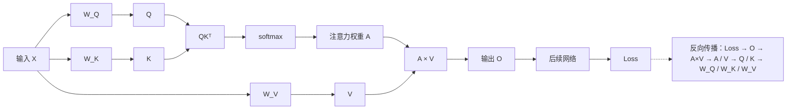

## 前言

总结一下Transformer的学习，突然发现基础还是比较重要的，也是通过了OpenAI研究员的自顶向下的学习方法，学习知识当中不断补充基础知识！Anyway，加油吧！写给正在进步的所有人！

## 一、什么是Attention

**一句话解释清楚：某个 token 根据自己的 Query 去和所有 token 的 Key 做匹配，然后按照匹配结果，从这些 token 的 Value 中按权重取回信息。**

计算流程：
```
输入 X
 ↓
线性变换
 ↓
Q, K, V
 ↓
QKᵀ / √dₖ
 ↓
softmax
 ↓
Attention 权重 A
 ↓
A × V
 ↓
新的 token 表示
```

以一个例子为例：
小明 把 苹果 吃了

对于传统的RNN来说，信息的传递：小明 → 把 → 苹果 → 吃了

小明需要经过很多步才能到吃了

但是对于Attention机制：
```
         ┌── 小明
         │
吃了 ────┼── 把
         │
         └── 苹果
```

“吃了”这一个单词对接所有的token

Attention解决的机制就是：应该对接哪些token，每个token看多少

## 二、数学公式

完整公式：
$$
\operatorname{Attention}(Q,K,V)
=
\operatorname{softmax}
\left(
\frac{QK^{T}}{\sqrt{d_k}}
\right)V
$$
前半段主要是解决的应该找谁：
$$
\operatorname{softmax}
\left(
\frac{QK^{T}}{\sqrt{d_k}}
\right)
$$
后半段负责拿什么样的信息：
$$
AV
$$

## 三、Q、K、V到底是什么

Q：代表我想找什么信息

K：代表我有什么样的信息
V：代表选了我能提供什么样的信息
关键点在于区分：K与V，**Key 是用来判断“要不要选我”的；Value 才是选中之后真正传递的信息。**

### 1.假设输入：

$$
X \in \mathbb{R}^{n \times d_{\text{model}}}
$$

n是token数量，d_model是每一个token的维度

例如：有4个token，每一个token的维度是512，那么x.shape = [4, 512]

Transformer不直接拿x做Attention，学习三个矩阵WQ，WK，WV（**注意：这三个矩阵都是训练出来的**）
$$
Q = XW_Q
$$

$$
K = XW_K
$$

$$
V = XW_V
$$

假设这三个矩阵的维度是[512,64]，同一个X进过三个不同的线性变换

所以计算的结果维度是：
```
Q: [4, 64]
K: [4, 64]
V: [4, 64]
```

对于同一个token，比如苹果，实际上会产生3种表示

```
苹果的 Query
苹果的 Key
苹果的 Value
```

### 2.Attention的计算以及why

举例有3个token，A，B，C。

假设Token A的Query是qA=[1,0]，三个token的key是
$$
k_A = [1,0]
$$

$$
k_B = [0,1]
$$

$$
k_C = [1,1]
$$

那么计算点击qA乘以他们三个的转置，也就是点积计算为[1,0,1]

然后再除以√2，经过softmax，最后得到的结果：

> attention ≈ [0.401, 0.198, 0.401]

也就是说
```
A 看自己：40.1%
A 看 B： 19.8%
A 看 C： 40.1%
```

假设各个value的值是这样，那么计算结果：
$$
v_A = [10,0]
$$

$$
v_B = [0,10]
$$

$$
v_C = [10,10]
$$

$$
output_A = 0.401v_A + 0.198v_B + 0.401v_C
$$

$$
output_A \approx [8.02,5.99]
$$

### 3.QKᵀ以及为什么要除以√d_k

- 其实QKᵀ就是计算token和token之间的关注度的，假设维度都是4x64，那么QKᵀ最后的维度是4

x4，对于4x4的矩阵来说，aij就是表示第 i 个 token 对第 j 个 token 的关注程度。1000个文本就是1000x1000，计算量是平方级，所以长上下文模型特别关注 Attention 优化

- 还有一个是为什么要除以√d_k，其实这个不是很难理解，主要是控制点积方差。这里说的方差，是指“很多次算出来的 dot product 结果，有多分散”。dk越大，那么更多的数字相加，点积的整体波动结果就会越大，除以√d_k就是把他缩回来。
- 为什么要缩回来：因为 **\(QK^T\) 后面马上要进 softmax**，而 softmax 对“大数”非常敏感；如果点积只是因为 \(d_k\) 变大而整体变大，softmax 会被“假装得很确定”。

## 四、self-Attention和上下文融合

### 1.self含义

**self的意思就是自己这条序列内部检索，经过Transformer变换了后，一个token所表达的意思不再只是简单指这个单词了，还包含这个单词的上下文关系**

### 2.上下文融合

符号含义：\[ H_2^1 \]：**第 1 层 Transformer 输出中，第 2 个 token 的表示向量。**

上下文融合发生在 `softmax(QKᵀ)V` 这一步：一个 token 会按照 Attention 权重，把其他 token 的 `V` 向量加权拿过来，混进自己的新表示里。

例子：小明 吃 苹果

假设第一层里，“吃”这个 token 算出来的 Attention 权重是：

```
看“小明”：0.3
看“吃”：  0.2
看“苹果”：0.5
```

那么“吃”这一个词的新的表示：
$$
H_2^1 = 0.3V_{\text{小明}} + 0.2V_{\text{吃}} + 0.5V_{\text{苹果}}
$$
这样依然表示“吃”这一个意思，但是混合了一些“谁吃”，“吃什么”这些信息

后面第二层Transformer继续拿第一层的输出在生成新的Q，K，V。

重要的一点：**每经过一层，token 不是“多记住几个词”，而是它自己的向量含义发生了改变。**

\[ \boxed{ \text{每一层都让每个 token 再看一遍其他 token，并更新一次自己对当前上下文的理解。} } \]

## 五、Cross-Attention

**Self-Attention 是“自己看自己”，Cross-Attention 是“Decoder 带着当前需求，去 Encoder 的结果里找对应信息”。**

在Self-Attention中，是一句话内部的token互相看

在Cross-Attention中，引入了encoder还有decoder，decoder去看encoder

q来自encoder，k，v来自decoder。也就是说q是需求提出者，kv来去哪里找信息

例子：
I love you

首先这三个token经过encoder，会得到3个上下文化向量表示：
```
I      → H_I
love   → H_love
you    → H_you
```

它们不是简单的单词embedding，是带了上下文的，比如说love这个token，不仅仅只代表love，更代表了I和you这些关系

接着decoder生产了“我”，预测下一个词生成什么

将当前这个状态通过线性变换得到Q

encoder里面的H_I，H_love，H_you转化为：
$$
K_I,\ K_{love},\ K_{you}
$$

$$
V_I,\ V_{love},\ V_{you}
$$

后面的计算过程和self-Attention一样，计算QKᵀ，然后乘以v

假设得到 Attention 权重：

```
I      0.1
love   0.8
you    0.1
```

那么就会得到：
$$
0.1V_I + 0.8V_{love} + 0.1V_{you}
$$
可以看到love的value的占比更高，所以下一个单词更容易预测“爱”

query是经过的decoder，KV经过的是decoder

**Encoder 是被检索的信息库**，其中 `K` 用来匹配，`V` 用来真正取内容。

## 六、Multi-Head Attention

单头的Attention会产生一个 Attention Matrix。但是一句话的关系显然不止一种，主谓关系，动宾关系，语义相关性等。

由此引出Multi-Head Attention，Transformer同时做很多组，每一个Head都有自己的投影矩阵：

```
                                    Head 1:
                                    Q₁ K₁ V₁

                                    Head 2:
                                    Q₂ K₂ V₂

                                    Head 3:
                                    Q₃ K₃ V₃

                                    ...

                                    Head h
```

还有一个我容易搞错的点，\(d_{model}\) 就是每个 token 当前表示向量的维度，在计算的时候，d_head一般都是d_model/heads，我就认为一个d_model是会被分成很多份的，但是其实不是硬切，每一个head的参数都会看到同一个向量。

```
                                    8维 token
                                        ↓
                                 ┌──────────────┐
                                 ↓              ↓
                                W_head1        W_head2
                                 ↓              ↓
                                4维            4维
                                 ↓              ↓
                                Head 1         Head 2
                                 └──────┬───────┘
                                        ↓
                                      concat
                                        ↓
                                       8维
```

每一个head都有一个QKV的参数，所以分别计算：
$$
head_i = Attention(Q_i, K_i, V_i)
$$
最后concat连接一下就行了，比如说你最后计算出来的有两个head：


$$
head_1 = [0.8, 0.3]
$$

$$
head_2 = [-0.4, 0.9]
$$

最后concat：
$$
[0.8, 0.3] \parallel [-0.4, 0.9]
$$
组合起来是[0.8,0.3,-0.4,0.9]，最后再经过投影矩阵即可

### 1.小问题：为什么需要经过投影矩阵

此时虽然已经是 8 维了，但前 4 维基本来自 Head 1，后 4 维来自 Head 2，彼此还只是“并排放着”。

然后乘：

\[ W_O\in\mathbb{R}^{8\times 8} \]

得到：

\[ [a,b,c,d,e,f,g,h]W_O = [y_1,y_2,\dots,y_8] \]

这里每个 \(y_i\) 都可以同时使用两个 head 的信息。

### 2. Multi-Head 通常不增加 Attention 投影的主要参数量

首先d_model是固定的，d_head = d_model / num_heads，所有的head拼起来依然是d_model，QKV投影的总参数量是不变的

**Multi-Head 不是把一份完整的 Q/K/V 复制成多份，而是把原本固定的 Q/K/V 输出维度拆成多个 Head。**

看似变多了，实际上是进行了一个拆分

举一个读书的例子：
我有一本100页的书，我把这100页，每20页拆分为一本新书，最后的看起来数是5本，但是实际上加起来还是100页，所以说总页数是没有变的

## 六、Decoder端的Mask

名词解释：
```
Causal Mask（因果掩码）= 让当前位置只能看自己和前面的 token，不能看后面的 token。
```

训练的时候需要这个因果掩码，是因为 Transformer 会把整句话一次性送进去并行计算，而我们又必须模拟“生成时看不到未来答案”的条件。

### 1.为什么需要Mask？

这里很坑

例子：`<BOS>` 我 爱 苹果

以这个为例，当你走到我的时候，你需要预测的下一个词是“爱”

也就是说：

```
位置1：看到 <BOS>          → 预测 我
位置2：看到 <BOS> 我       → 预测 爱
位置3：看到 <BOS> 我 爱    → 预测 苹果
位置4：看到 <BOS> 我 爱 苹果 → 预测 <EOS>
```

但 Transformer 为了效率，不是分 4 次跑，而是一次把：

```
<BOS> 我 爱 苹果
```

全放进去。

但是如果不通过causal mask的话，会出现这个情况：
```
          <BOS>    我      爱     苹果
<BOS>      1.2    0.3     0.8    0.6
我         0.4    1.5     2.1    0.9
爱         0.2    0.7     1.3    1.8
苹果       0.1    0.5     0.9    1.7
```

也就是说“我”这个词后面是强烈关注“爱”的

而这里位置2要预测的答案 = 爱，所以就泄露答案了

如果这里有点懵逼，举一个例子就懂了

```
假如你是一个高考生，你现在要做题目
题目：我是___
答案：帅哥

你看到这个题目了，是不是直接就把“帅哥”两个字直接填上去了
但是其实平常做题训练，你是不应该看到答案的，也就是说你所看到的应该是
题目：我是___
```

所以引入causal mask了之后，当你走到“我”的时候，你只能看到“`<BOS>` 我”，走到爱的时候，只能看到“`<BOS>` 我 爱”。

```
原始得分：
<BOS>    我      爱     苹果
 0.4    1.5     2.1     0.9
经过causal mask了之后
<BOS>    我      爱      苹果
 0.4    1.5     -∞      -∞
```

经过softmax了之后-∞对应的都是，softmax是e的多少次方的函数

### 2.易混点

**被 mask 成 0 的是“对未来 token 的 Attention 权重”，不是“预测这个词的概率”。**

上面的“爱”最后会变为0，但是你预测“爱”这个词的概率不是0，后面会算出一个新的向量，然后经过词表投影，最后softmax，得到一个概率，假如如下：
```
P(爱)   = 0.72
P(喜欢) = 0.12
P(我)   = 0.05
...
```

那么你下个词预测的概率就是“爱”

## 七、训练可以并行，但是推理不可以并行

训练时可以并行，是因为可以使用causal mask，一次计算所有的位置

上面的mask已经讲的很清楚了，在训练的时候，你把`<BOS>` 我 爱 苹果丢给模型即可，然后通过causal mask即可计算预测下一次词的概率

但是在推理阶段：：**推理时第 `t+1` 个 token 本身还不存在，所以你没法提前计算依赖它的第 `t+2` 个**

我爱苹果，才推理到“我”这个词，你咋可能把“苹果”这个词推理出来

它是依赖一个序列的，所以不可以并行

## 八、训练\(W_Q,W_K,W_V\) 

这一部分就是从理论到训练，这一部分的重点就是：**\(W_Q,W_K,W_V\) 并不是直接“学会谁该关注谁”，而是通过反向传播不断被微调，使得 \(QK^T\) 产生更有用的注意力分布，同时让 \(V\) 提供更有用的信息**



比如一句话：

> The animal didn't cross the street because **it** was tired.

处理 `it` 时，模型可能需要让 `it` 更多关注 `animal`。但模型一开始并不知道这条规则。

`it` 的输入向量是 \(x_{it}\)，经过：
$$
q_{it} = x_{it}W_Q
$$

`animal` 的输入向量经过：
$$
k_{animal} = x_{animal}W_K
$$
两者的注意力分数：
$$
s_{it,animal}
=
\frac{q_{it}k_{animal}^{T}}{\sqrt{d}}
$$
如果训练时模型最终预测错了，Loss 就会产生梯度。假设梯度最终表达出来的效果是：

> 当前 `it → animal` 的注意力应该再强一点。

那么它首先要修改的是这个分数：

\[ s_{it,animal} \]

而这个分数由 \(Q,K\) 决定，所以梯度继续传：

\[ S\rightarrow Q,K \]

其中：
$$
\frac{\partial L}{\partial Q}
=
\frac{\partial L}{\partial S}
\frac{K}{\sqrt{d}}
$$

$$
\frac{\partial L}{\partial K}
=
\left(
\frac{\partial L}{\partial S}
\right)^T
\frac{Q}{\sqrt{d}}
$$

这一步真正的含义是：

> 如果某个 Q-K 配对导致了错误的注意力，  
> 就调整产生这些 Q 和 K 的方向。

但是 **Q 和 K 本身不是长期保存的参数。** 每句话进来，Q/K 都重新计算：

$$
Q = XW_Q
$$

所以真正需要修改的是 WQ：

$$
\frac{\partial L}{\partial W_Q}
=
X^T
\frac{\partial L}{\partial Q}
$$

然后优化器执行类似：

$$
W_Q
\leftarrow
W_Q
-
\eta
\frac{\partial L}{\partial W_Q}
$$

这里：

**梯度 = 告诉参数朝哪个方向改，Loss 会下降。**

**学习率 \(\eta\) = 每次改多少。**

### 1.注意softmax函数

**Softmax 作用在一组数上以后，这组输出一定都在 \(0\sim1\) 之间，而且加起来严格等于 1**。所以它特别适合把一组“原始分数”变成“权重分配”。

### 2.\(W_V\)

 \(W_V\) 学的是：

> 如果别人来读取这个 token，我应该提供哪种表示？

**O=AV**

数学上：
$$
\frac{\partial L}{\partial V}
=
A^T
\frac{\partial L}{\partial O}
$$

因为：

$$
V = XW_V
$$

所以：

$$
\frac{\partial L}{\partial W_V}
=
X^T
\frac{\partial L}{\partial V}
$$
同一个 \(W_Q,W_K,W_V\) 会用于大量 token，**所有 token 共用这套投影规则，本质上就是训练把 \(W_Q,W_K\) 调到了一个向量空间中，使需要互相关联的表示往往获得更大的点积；同时 \(W_V\) 学会在被读取时提供对最终任务有用的信息。**

### 3.QK一个空间，V一个空间

QK主要是用来觉得两个token是否相关联

V用来传输真正的信息

## 九、Attention与FNN（写到这里我头已经昏了）

**Attention 负责“去别的 token 那里拿信息”，FFN 负责“拿到信息以后，在当前 token 内部加工成新的特征”**

假设序列矩阵是：

$$
X \in \mathbb{R}^{n \times d}
$$

$n$ 是 token 数，$d$ 是每个 token 的特征维度。Attention 做的是：

$$
Q = XW_Q,\quad K = XW_K,\quad V = XW_V
$$

$$
A = \operatorname{softmax}
\left(
\frac{QK^T}{\sqrt{d_k}}
\right)
$$

$$
Y = AV
$$

这里真正体现 **token mixing** 的是注意力矩阵：

$$
A \in \mathbb{R}^{n \times n}
$$

Aij表示：第 \(i\) 个 token 从第 \(j\) 个 token 的 Value 中取多少信息。

**信息拿过来了，不代表已经把这些信息处理好了。**

FFN 对每个 token 单独执行：

$$
FFN(x) = W_2 \sigma(W_1 x + b_1) + b_2
$$
第一个线性层：

$$
W_1x + b_1
$$

负责把 token 的特征从原来的维度扩展到更高维空间。

然后经过激活函数：

$$
\sigma(W_1x + b_1)
$$

对特征进行**非线性变换**。

最后经过第二个线性层：

$$
W_2\sigma(W_1x + b_1) + b_2
$$

把高维特征重新压回原来的维度。

所以整个 FFN 可以理解为：

$$
d_{\text{model}}
\rightarrow
d_{\text{ff}}
\rightarrow
d_{\text{model}}
$$

也就是：

**升维 → 非线性变换 → 降维。**

如果只有 Attention + Linear：

> 整体表达能力中的非线性变换不足。

FFN 提供强大的非线性 feature transformation。

现代 Transformer 里 FFN 通常甚至占了绝大部分参数量。

## 十、Position Encoding

Attention 本身有一个非常重要的性质：

> **它不知道顺序。**

“你打我”和“我打你”是一样的，没有任何的位置信息，token只是集合。所以必须给token embedding加上位置信息，这样Attention才能学习到位置关系
$$
X = TokenEmbedding + PositionEmbedding
$$
假设 token embedding 和 position embedding 都是 $d$ 维：

$$
x = e_{\text{token}} + e_{\text{pos}}
$$

进入 Attention 后：

$$
Q = xW_Q
$$

利用线性运算的分配律：

$$
Q = (e_{\text{token}} + e_{\text{pos}})W_Q
= e_{\text{token}}W_Q + e_{\text{pos}}W_Q
$$

这就是关键：**虽然输入阶段加在一起，但线性投影之后，两部分仍然分别产生自己的贡献。**

## 十一、Encoder与Decoder

```
Encoder Self-Attention
Q = K = V = Encoder
作用：source 内部互相理解
范围：整个 source

Decoder Masked Self-Attention
Q = K = V = Decoder
作用：理解已经生成的 target
范围：只能看左边

Decoder Cross-Attention
Q = Decoder
K = V = Encoder
作用：生成 target 时查询 source
范围：可以看整个 source
```

真正的分界点是 **Q 从哪里来**：

```
Q 来自 Encoder → “source 中这个词应该关注 source 的哪些词？”

Q 来自 Decoder，K/V 来自 Encoder
→ “我现在要生成下一个词，应该去 source 的哪里找信息？”
```

整个 Encoder-Decoder 记成一句非常形象的话：

```
Encoder：把原文全部读完，做成一份“可查询的理解结果”。

Decoder：
先看自己已经写了什么，
再拿当前问题去查 Encoder 的理解结果，
然后写下一个词。
```
